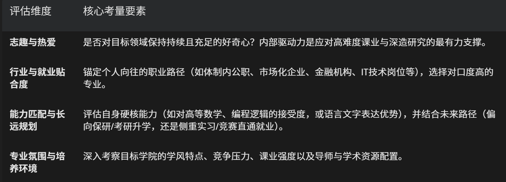
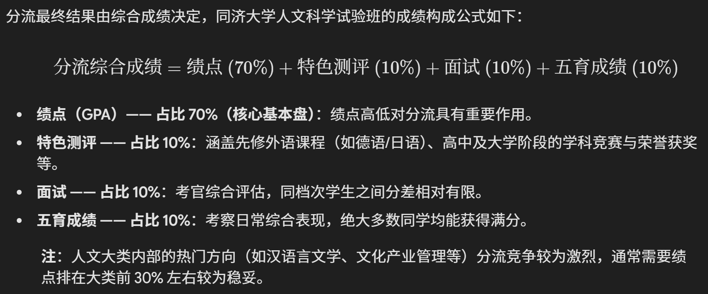
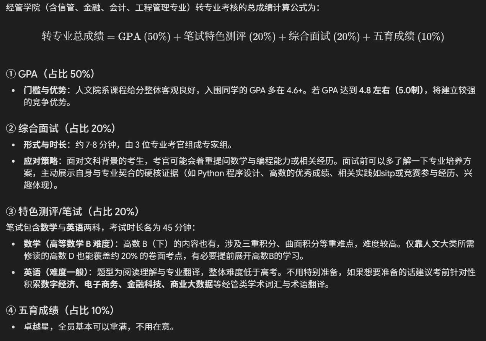

# 从人文到信管

## \*写在前头：

①在大一学习阶段，对专业方向感到困惑、选择随认知加深而频繁调整，甚至到学期末依然未能明确最终定位，均属于极其正常的探索过程，不必陷入无谓的焦虑与自我内耗。

②大学的专业选择固然重要，但它绝非决定人生发展的唯一路径。比起“寻找一个完美专业”，更重要的是培养解决复杂问题的底层能力，并建立坚韧强大的心理素质。

**面对大类分流与跨类转专业，建议确立如下两个基本认知：**

①能明确自己“想做什么”，或者至少明白自己“不喜欢什么”，通过“排除法”锁定自己“绝对不适合/不接受的领域”（如课程承载极限、未来职业形态），同样能有效收窄决策范围。

②同济大学提供了多次转专业机会（包括新生二次选拔、大一下跨类转专业、大二上特长转专业、大二下兴趣转专业等），所以我鼓励大家保持开放、敢于尝试的心态，不必过度恐惧试错。

## \*如何选择专业？

我在专业选择时大概考虑了以下**四个**维度：

转专业千万不要盲目跟风，要进行理性客观的分析，**倾听自己内心最真实的声音，**可以问问自己：

①现专业不适合自己的根源何在？

是课程难度超出个人能力极限（学业承载问题），还是就业去向与个人发展规划冲突，抑或是单纯缺乏内在兴趣？

②目标专业的实际门槛与转入代价是什么？

目标专业的绩点门槛与竞争报录比如何？

转入后的核心硬核课程（如数学类、编程类、经济学基础）能否顺利消化？

是否面临补修大量学分，甚至需选择降转的学业成本？

③获取的信息是否具备客观性与全面性？

是否已查阅目标专业的官方培养方案，并向多位直系学长学姐进行多维度打听？

可通过xhs/校圈/转专业交流群/高中直系学长学姐/朋辈对话活动等增进了解

**需注意“千人千面”，每个人的体验均带有主观色彩，必须结合自身实际情况研判利弊。**

## \*类内分流与跨类分流

时间线大致如下（大一下进行）：

11周周末/12周周中：公布相关通知

12周周末：填报志愿（类内排序+跨类平行填3个）

13周周末：类内分流面试

14周周中：跨类考核

期末成绩出完之后，先公布类内分流志愿（可放弃跨类志愿），再出跨类录取名单（再次确认）

### ——人文科学试验班分流机制（以2025级为例）：

可分流专业：

人文学院：汉语言文学、文化产业管理、哲学

外国语学院：英语、日语、德语

艺术与传媒学院：传播学

### ——信息管理与信息系统跨类考核机制（以2025级为例，名额2个）：

考核标准：

## \*是否需要降转？

跨类转入信管专业后，大一学年需补修的核心学分差距如下：

大一上学期需补修课程：管理学概论、高等数学 B（上）、线性代数 B、经管类专业导论。

大一下学期需补修课程：高等数学 B（下）、概率论与数理统计、会计学、宏微观经济学、*人工智能与技术（人文大类同名课程通常可进行学分认定）*。

1. 提前跨类选课技巧：若在大一上学期即明确转专业意向，可在选课阶段（跨学科选课）申请跨类修重难点课程（例如直接修读高数 B 以替代人文大类要求的高数 D）。**风险提示：高数 B 难度远高于高数 D，若缺乏数学基础可能影响当学期 GPA，需审慎权衡。**

②可以考虑学院政策与学业压力（文科跨入经管类，学院通常建议或鼓励选择降转。但也可以平转）和个人发展节奏（结合个人的学习适应能力、抗压水平以及未来保研、考研或出国申请的时间节点综合判断）

## \*如何备战转专业？

①提前了解转专业考核内容，可以提前准备，例如自学高数B（网课、线下跟班）。同时搞好绩点，对分流和跨类都有优势。

②保持平稳的心态，相信自己，大胆尝试。

**世界足够辽阔，人生的容错率其实很高，祝大家都能去到心仪的专业，做自己想做的事！**
