# 24 机械 to 平转微电子：

孩子们，这一天我已经等待很久了。一直沐浴在转群大佬们的帮助之下，经历了地狱一般的平转一周和走手续的一个月后，我终于打起精神，为分流后仍有转专业需求的同学写下这份经验分享和吐槽。

本教程会带大家梳理一遍转专业流程！

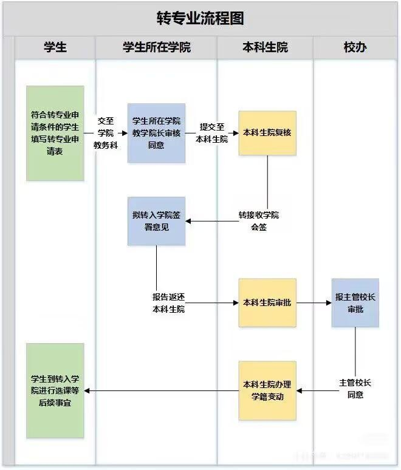

如上图：如果你想当一个转人，首先要弄清楚各个流程是什么。

## Step 1：填写申请信息

### 下载并填写申请表

在 1 系统中找到转专业申请表，下载后填写相关信息。

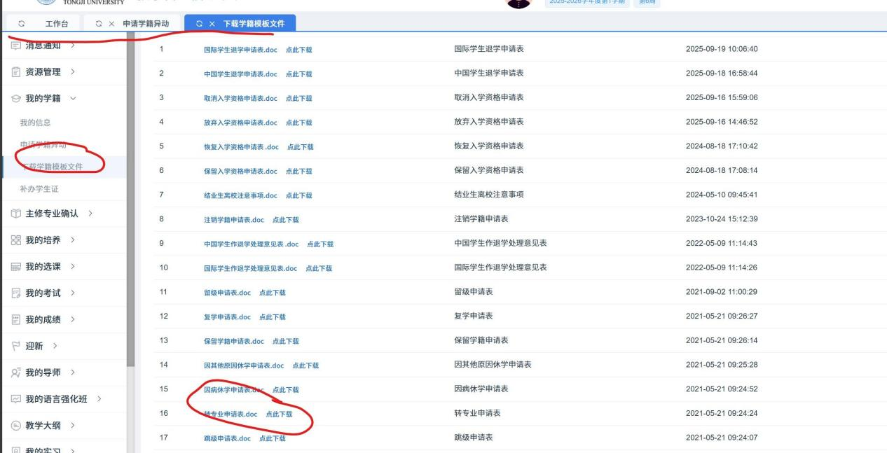

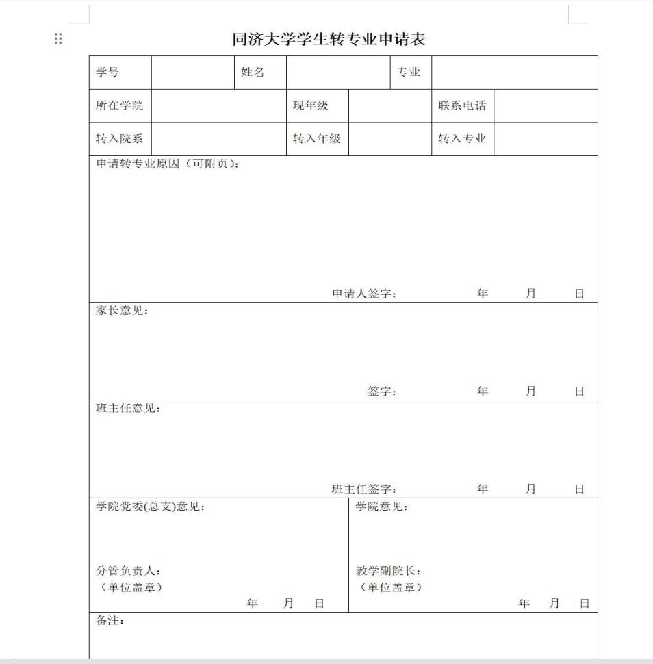

### 准备申请材料

申请材料准备两份，一份电子版，一份纸质版。嘉定 f 楼可以自主打印，也可以去打印店打印。

接下来准备申请表要求的材料。就我了解到的情况，学校对申请材料的具体要求并不明确，后续环节还可能提出补充要求（见后文）。我把材料作为附件提交。下面是我的转专业理由，供大家参考。在此感谢一位 23 级的直系学长，他的经验给了我很大帮助：

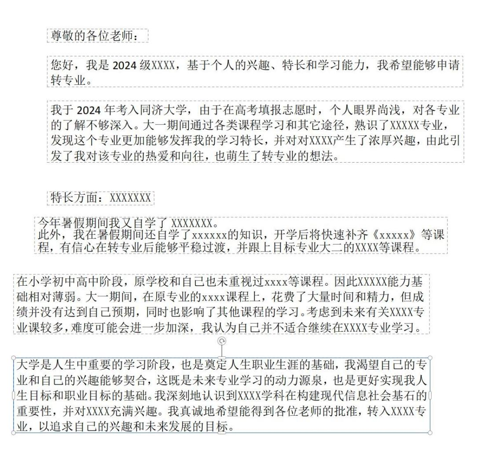

每个人提交的材料都不一样，比较常见的有：

- SITP
- 高中竞赛、大学竞赛（校赛或者比较水的比赛）
- 相关课设、自制项目

SITP 的含金量相对较高，高中竞赛和项目经历也可以作为参考（后文会具体说明）。根据自己的经历准备能展示能力的材料，并同时准备电子版和纸质版。

所有材料都必须在开学第一周内上交。这里说的“上交”不是指你准备好材料的时间，而是指材料交到教务、完成学院转出评估的时间。材料交给本学院教务后，还需要教务和学院领导审核、签字，这些流程都需要时间。

因此，务必提前准备并尽早提交材料。不同学院的办理效率不一样，有的学院会统一办理，有的则需要学生主动跟进。要多去办公室走动，也要及时打电话询问教务，了解办理进度。

## Step 2：本学院转出与本科生院审核

### 本学院转出评估

通过本学院的转出评估，意味着你度过了相对煎熬的第一周。但不是所有同学都能确定转出成功，因此建议暂时保留原专业课程，做好两手准备（选课安排见后文）。

### 本科生院审核

接下来是本科生院的第一次审核。今年本科生院的审核力度加大，申请材料尤其重要，建议认真准备：

- SITP 需要结题文件，只有立项或升级的材料不予认可。
- 高中竞赛可能会被认可。

我个人认为，今年本科生院不认可计算机类自制小程序项目，毕竟 AI 工具人人都能使用。校内比赛和水赛也可以作为材料准备。

从结果来看，大部分申请大二转专业的同学在大一时成绩都比较扎实。说句直接的话，本科生院审核时可能更看重有正式证明的材料，而不只是个人潜力。今年不少同学在第二周收到通知，需要在当天晚上前补齐证明材料。可能是因为 2025 年申请转专业的人数较多，本科生院的审核也更严格了。

## Step 3：接收学院考核

### 等待考核通知

如果本科生院审核通过，转出学院教务就能在 OA（行政管理系统）中看到相关信息，之后你就进入接收学院的考核环节。

等待期间可能会比较煎熬。不同学院的考核进度不同，有的学院在国庆前就完成考核，有的则会持续到国庆期间或之后。因此，从第二周到第三周、甚至第四周，都要主动跟进：礼貌地联系接收学院教务，询问考核时间和进度安排。

也可以向成功转入的同学了解考核内容和经验，认真准备面试。同时，继续学习原专业课程，等待考核结果。

### 参加面试

面试通常会围绕申请材料和个人情况提问。面试老师可能在线上或线下参加，具体形式以学院安排为准。记得准时参加，并提前检查设备和网络。

面试环节也有一些学校特色，具体情况可以咨询成功转入的同学。问题可能从 GPA 延伸到某门具体课程。与大类分流中偏聊天式的面试不同，转专业面试会结合你提交的材料提问；具体形式因学院而异，一般不会突然要求你回答技术性问题。回答时不要夸大经历，老师能够看到你提交的材料。

面试结束后，继续关注结果。可以每隔两天打一次电话，或每隔三天去办公室询问一次。

## Step 4：转入后的课程衔接

收到转入学院的通知后，基本上就可以庆祝了（只是基本上）。

### 学籍变更与旁听

接下来最头痛的，是补上落下的课程。各学院接收学生的时间不同，学籍变更时间也不同。选课必须等学籍变更后才能进行，记得关注 1 系统。因此，在学籍变更前，可以先查阅全校课表，为自己拟一份临时课表，并按课表旁听相关课程。

这期间可以请教务打印 OA 文件，再联系各门课程的老师，加入课程微信群、QQ群和智慧树课程。之后还要加入小组群，跟进作业和网课等安排。

拿到 OA 后，可以向老师说明自己的情况，争取补上这段时间的出勤和课程安排（具体要看老师的要求）。拿到 OA 后也可以联系公寓部申请换寝室，具体见下文。其他事项还可以继续询问教务。

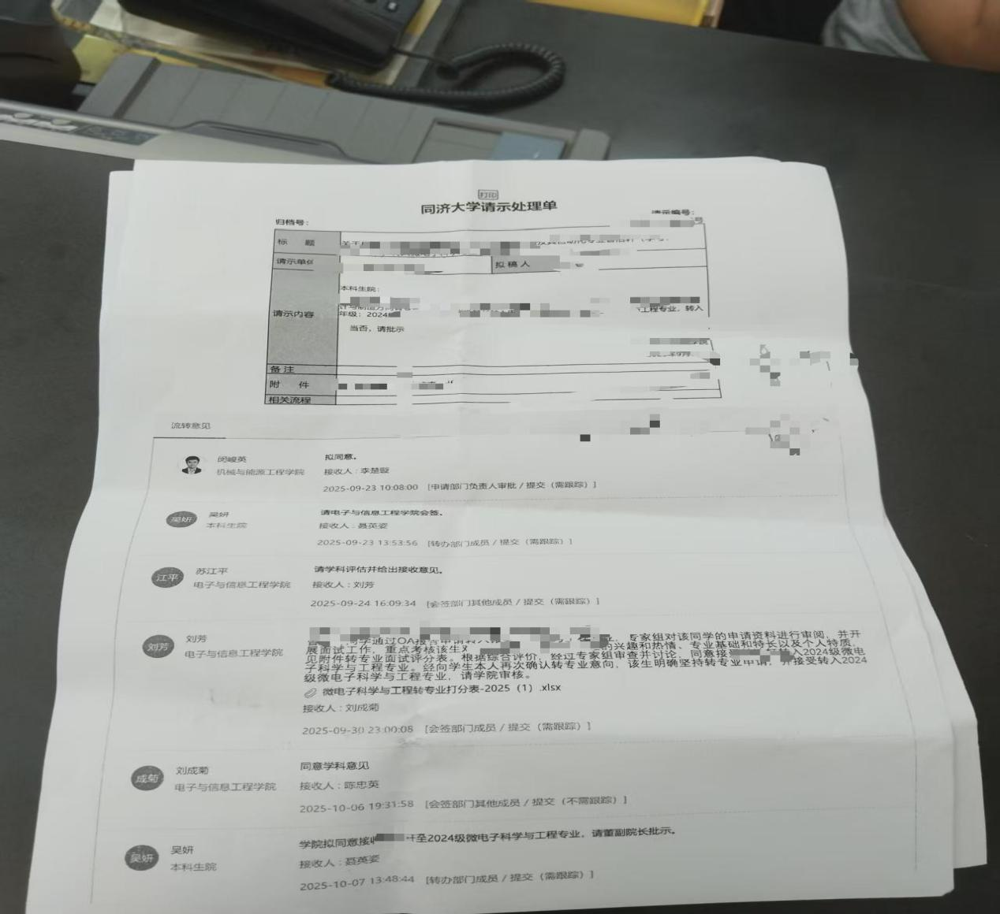

## Step 5：换寝室与选课

拿到 OA 后，你可以开始按临时课表旁听。但临时课表不能替代正式选课，还要及时关注选课和宿舍安排。很多转专业的同学会忽略这段时间需要尽快行动；换寝室时，合适的宿舍可能只剩下少量空床位。

### 换寝室

有人听宿管阿姨说“本学期换寝室申请请交到网上”，提交后就一直等通知。按我的经历，拿到 OA 后可以直接联系公寓部，了解换寝室的办理方式，并说明自己转专业的情况。沟通时灵活一些，也可以询问是否需要教务说明情况。我当时是说已经找教务沟通过。嘉定校区的公寓部在二号楼下面的自行车停放点内，从一个小门进入。

### 退改选课

学籍变更后，要尽快联系学院教务办理选课。晚了可能只剩下评价不高的老师，甚至没有可选课程。有的课程即使只差几个名额也无法扩容；本学院教务只能帮忙扩本学院的课程，扩容也会受教师等客观因素影响。因此，平转同学尤其要抓紧时间。

### 选课成功后：补课与作业

选上课程，说明学籍已经变更，也意味着通过了本科生院的第二次审核。转入学院通过初审后仍有可能被刷掉，具体原因不明。接下来要尽快补课、补作业。作业和汇报可能会很多，提前做好心理准备。

不过恭喜你，历经了一个月的风雨与心理折磨，你成功了，恭喜！可以当转专业群的管理员了！

## 转专业过程中的几点建议

### 1. 平转还是降转

先转入专业，再决定是否降转。降转不会让考核更容易。若有较多数学或基础课需要补修，教务和行政老师可能会建议降转，最终还是要结合自己的情况决定。24 级课程和学分压力较大；25 级有卓班、国豪扩招政策和一些新课程、新政策。

### 2. 主动联系辅导员和教务

无论是本科生院还是转入、转出学院的辅导员和教务，都是办理流程的重要联系人。遇到进度问题，要主动询问、及时跟进，也要保持基本的尊重和体谅。即使最后没有转成功，耽误的原专业课程和由此产生的压力也需要自己承担，因此要对自己的选择负责。

### 3. 想清楚自己的目标，保持良好心态

现在转专业的同学越来越多，大学学习也越来越应试化。每个人转出或转入专业，都是自己的选择；转专业也意味着承担一个月左右的心理压力和 all in 的代价。

转群里有理工科成绩优秀的同学转入哲学，有文科同学转入工科后又想转理科，也有同学跨两级、三级转专业。还有人放弃大家都向往的码电类专业，选择看起来不那么热门的方向。转专业前后都要保持良好心态，想清楚自己的大学目标和对专业的理解，找到 GPA 和专业排名之外支撑自己选择的理由。记住：“除了自己，没人会对你负责。”

应转尽转。。。。。。。应转尽转。。。。。

## 7.24 转专业分享会

下面结合我的经历，聊聊想转入微电子时可以重点关注的事项。

我会从转专业流程、申请材料、课程安排和微电子专业情况四个方面补充说明。

### 一、转专业流程补充说明

#### 1.1 提交材料的时间

据我了解，学院教务收到转出材料后，通常不会马上交给本科生院，而是集中处理。以机械学院为例，教务可能会在第一周周五收齐材料，并在周末或周五晚上提交本科生院。

本科生院收到材料后，通常会在星期一或星期二处理，也可能在星期二给出审核结果。你提交的材料可能需要先交给辅导员，由辅导员协助签字，再交给教务。因此，要主动确认材料是否已经交到教务，以及教务是否已经提交给本科生院。

材料一般要在第一周提交，但准备过程中可能遇到签字、整理材料、教务不在办公室、联系不上老师等情况。建议在开学前尽量准备好材料，给签字和提交留出时间。

#### 1.2 申请材料准备

如果你计划大二时申请兴趣转专业，尤其是现在还在大一，能准备的经历可能有限：SITP 还没有结题，论文还没有完成，竞赛经历也可能不多。大一期间也有物理、数学竞赛、高中竞赛和水赛等机会，如果与目标专业契合，也可以作为参考。

如果 GPA 不占优势，可以考虑准备一个与目标专业相关的项目，帮助本科生院和接收学院了解你的兴趣与准备情况。我是微电子专业的学生，结合自己的经历，下面介绍三个可以考虑的方向。这些只是建议，并非我亲自实践后的结论，实际效果还需要自行判断。

##### 1.2.1 一生一芯

一生一芯是面向本科生的免费教学计划，提供 IC 设计网课和实验机会。想转入微电子的同学，可能较难准备出与专业方向高度相关的项目：

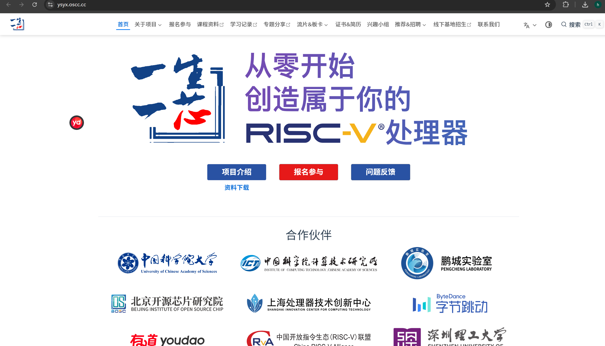

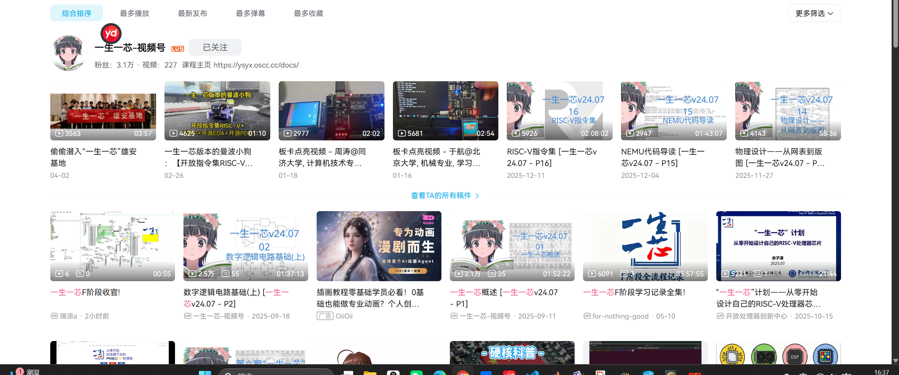

一生一芯有不同的学习进度。你可以说明自己在项目中完成了哪些内容。项目还会提供证书和伴手礼。即使 GPA 不低，申请时也可能遇到材料审核；IC 设计相关的学习经历，或许能作为专业准备的证明。

你可以跟着课程学习并完成实验，逐步积累项目进度。如果暑假能投入更多时间，取得较好的进度，就可以向本科生院说明自己具备一定的 IC 设计基础。后续如果打算参加相关比赛，这段学习经历也可能有帮助。

电院的一些实验课程和小学期会涉及单片机设计或 Verilog 等内容。提前学习这些知识，对后续课程也有帮助。

转专业后，你可能会遇到不适应或知识缺口。与已经完成大一课程的同学相比，提前参与项目可以帮助你补充一些基础。

这个是知乎的评价：

<https://www.zhihu.com/question/409298856>

##### 1.2.2 FPGA 项目

第二个可以考虑的方向是 FPGA 项目。你也可以用单片机、STM32 或 51 单片机做物联网功能。我转专业时曾把工程实践中的小机器人项目整理成图片，连同代码一起提交，但我觉得它和微电子专业的契合度不高。因此，我更建议尝试用 FPGA 设计一个 CPU。GitHub 上有不少相关代码，可以参考并尝试完成自己的项目。这样的项目与专业方向更贴近。

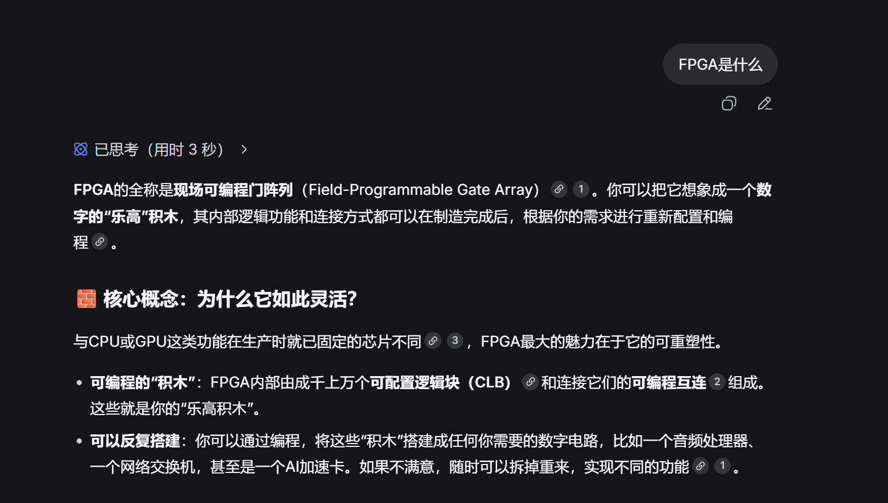

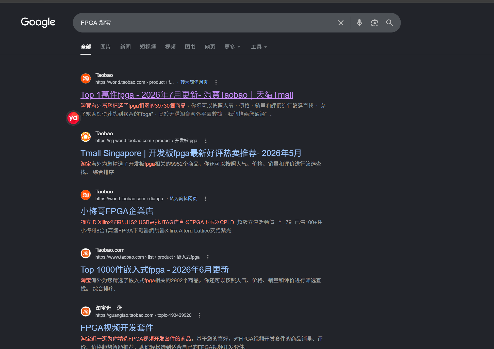

不过，老师和本科生院是否认可项目，不是我能决定的。计算机专业也有不少同学准备了项目，但仍未通过审核。申请结果可能还会受到 GPA 和申请人数等因素影响，具体情况很难预料。

##### 1.2.3 学科竞赛

竞赛也是比较有说服力的材料。如果你刚进入大一，可以关注数学、物理类竞赛，例如美赛、数学竞赛和数学建模比赛。你可以加入相关微信群，也可以联系机械学院的段春燕教授了解信息。本科生院可能比较关注竞赛，因为竞赛材料通常有正式盖章。

如果已经读完大一，可以考虑在暑假参加数学建模比赛或全球人工智能算法校园精英大赛，这些比赛都可以加分。全国数模的获奖难度相对较高，后者的获奖率似乎更高。注意查看报名时间，来得及的话可以报名。获奖对保研也有加分作用，后者好像属于 C 类比赛。

转入后，参加竞赛和科研的时间可能会比较有限。如果能在这段时间参加比赛并取得不错的成绩，之后与同专业同学竞争时也可能更有优势。

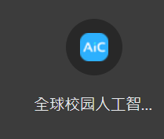

以上说明都是建议，不清楚是不是有人实践过，但是我个人反思一下这些路径好像还挺有用的，就算你大二上没转成功，但是把这些事情做好了，大二下应该比较稳，而且本身都是一石二鸟的。

### 二、课程规划与学习安排

#### 2.1 平转还是降转？

转专业后，能调整的空间比较有限，因为第一个学期的课程通常会比较多。平转的课程压力尤其大；降转则可能有更宽裕的时间安排。

如果在考虑降转，我建议先读一年再决定。读一年后，如果课程补不完或压力过大，再考虑退课和降转；也可以先按降转的打算读一年，实际体验电院课程的难度。

通过这一年的学习，你可以判断微电子是否符合预期，也能了解课程和竞争的实际难度，再决定是否降转。大三降到大二，相比大二降到大一，通常会有更多积累。

无论是做科研、参加比赛还是找实习，多一年的时间都能帮助你积累经验、提升认知，也能增强竞争力。

每个人的规划不同，是否降转还是要结合自己的情况决定。

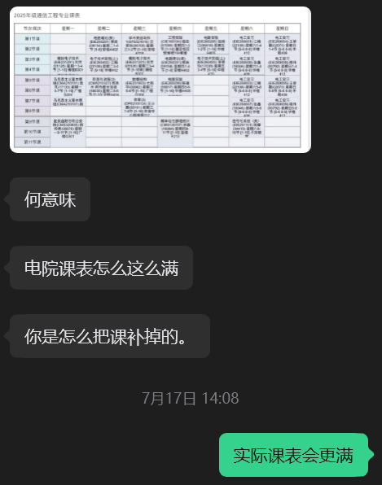

#### 2.2 微电子课程安排

##### 2.2.1 高程

平转时课程比较多，高程的优先级可以适当降低，需要时也可以考虑放掉部分课程。

如果平时作业和大作业都主要依赖 AI，虽然能学到一些内容，但收获可能有限。对我这样的零基础学生来说，平转时同时学高程和电路，确实很难有足够时间深入思考。结合我的理解和经历，这门课的成绩主要看期末表现。期末准备充分，拿到“良”或“优”并非难事，不一定只能得到“中良”。

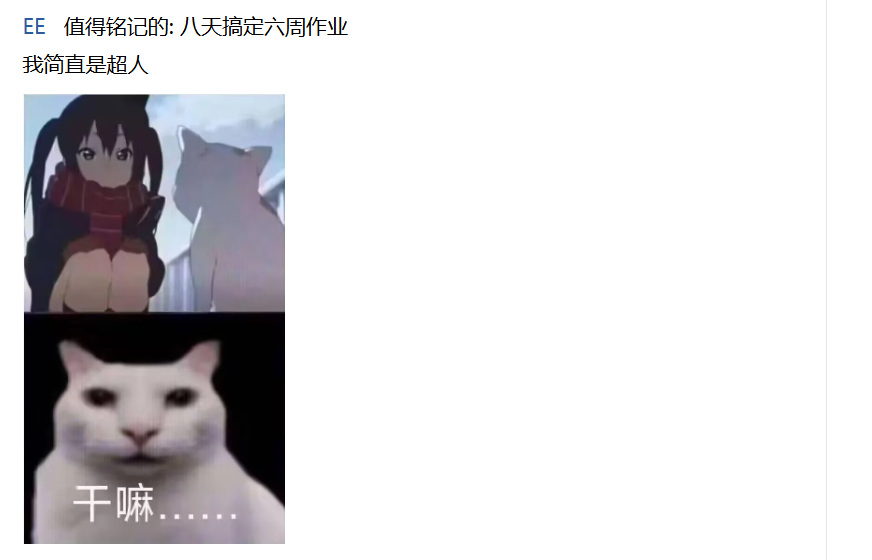

##### 2.2.2 课程优先级

课程之间也需要安排优先级。我建议的顺序是：

电路\>模电\>复变\>高程\>线代

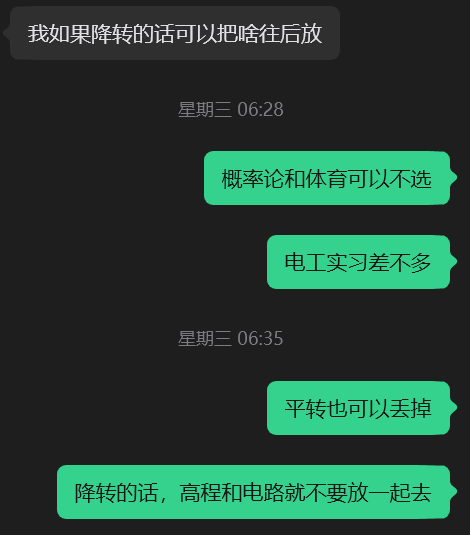

这些课程里，电路和高程比较耗时间。电路最好认真学扎实；高程的安排前面已经说过。

模电方面，我推荐选择英文模电。如果你在电院或微电子专业，这门课应该由刘芳老师授课。按我的体验，刘芳老师给分不错，使用的教材也很经典。如果能认真学完教材，基础会比较扎实。

如果未来想从事模拟设计，模电尤其重要。微电子专业大三还有一门模集，与模电关系紧密。如果模电基础没打好，之后学习模集可能会比较吃力。

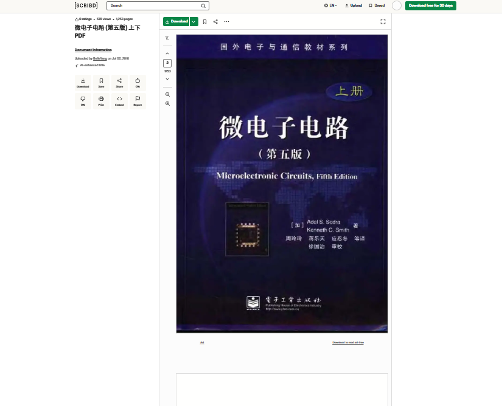

##### 2.2.3 线性代数

平转的话，高程和电路可以放在同一学期；降转的话，尽量把这两门课分开。我根据自己的经历反思后觉得，平转的第一个学期可以暂缓修读线性代数，放到大三学也可以。

24 级入学时，这门课的考试比较简单。线性代数对后续专业课有帮助，但帮助没有特别大。电路实验和模电实验则建议选上。

##### 2.2.4 电工实习

电院有一门周末开设的电工实习课。我得知自己转专业成功并去选课时，已经是第 8 周左右、接近国庆节了；但电工实习似乎在第 6 或第 7 周就开始了。也就是说，等你选上这门课时，课程可能已经接近结束。

如果转入微电子前没有修过电工实习，后续的小学期就要多花些时间补基础，例如焊接。小学期会焊接并制作万用表；如果没上过电工实习，洞洞板、PCB 等内容对你来说可能都是零基础。可以提前了解这些内容，或想办法在 OA 办妥前先跟着上课。

##### 2.2.5 专业导论和英语课

我选的是英语学术写作。这门课内容不难，但事情比较多，建议放到大三修读。专业导论的事务也比较多，具体给分情况我不太清楚。

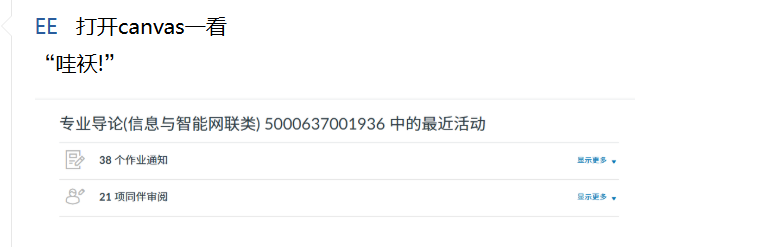

### 三、微电子专业情况

接下来就讨论一下，我们学校微电子到底是什么样的。

同济大学微电子专业的知乎讨论：\
<https://www.zhihu.com/question/56968416>

微电子学院官网：

https://est.tongji.edu.cn/xgk/list.htm

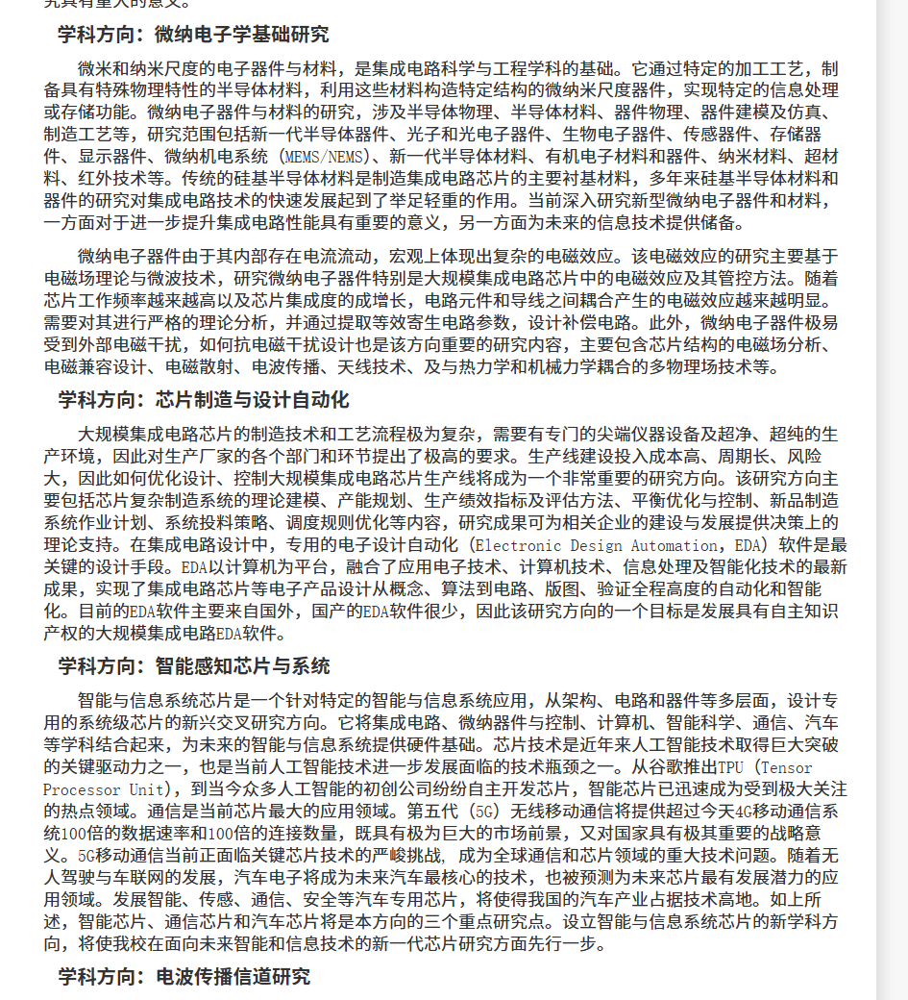

#### 3.1 常见问题

有同学问过我一个问题：

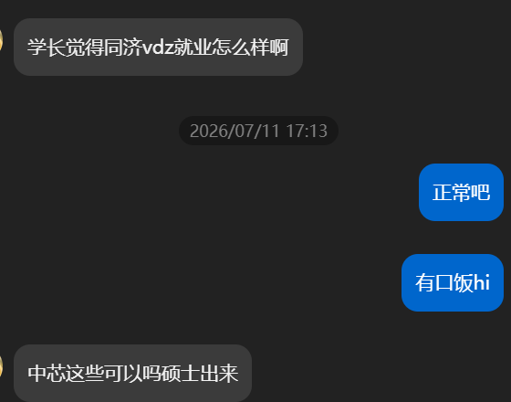

还有一个同学是这样问我的，我一下没找到截图。

“你们微电子同济，微电子是不是毕业了就没法搞设计？”

关键在于你自己是否喜欢、是否适合。微电子有不同的研究和就业方向，新来的老师也不错。建议先做好规划，结合具体岗位和自己的目标，持续积累相关能力。就同济微电子而言，求学过程中可能会遇到一些小困难，但不至于吃大亏。

#### 3.2 学习竞争与转入情况

同济微电子学生之间的竞争压力比较大，GPA 应该处于电院前列。一般来说，每学期都会公布成绩单和 GPA。具体情况可以向电院辅导员或教务咨询。往年大二上转入的人数大概每次不超过 5 个。

### 四、转专业前需要考虑的事情

#### 4.1 留意政策变化

学校的转专业政策每年都可能变化，我最近没有持续关注最新政策。前文的经验主要面向大一学生；如果你已经读到大二或计划降转，具体情况可能不同，可以把前面的建议作为参考。

#### 4.2 大一阶段优先稳住 GPA

对大一学生来说，转专业政策和考核难度每年都可能变化。很多准备工作可以兼顾其他目标，而大一最重要的事情之一就是保持 GPA。GPA 足够高，选择空间会更大；即使本科学院暂时没有放行，也可以再等待下一个机会。

#### 4.3 关注跨类分流机会

对很多同学来说，跨类分流可能比兴趣转更适合作为转专业机会，因为流程和评价相对透明，通常可以根据 GPA 等公开信息进行准备。

#### 4.4 提前考虑备选方向

如果进不了微电子，可以考虑通信；如果进不了通信且 GPA 较高，也可以了解自动化等方向。微电子的竞争相对激烈。学校每年可能会扩招或设置特殊班型，其中也可能包括微电子；双学位项目也会带来额外的竞争。填报前可以结合自己的兴趣、成绩和培养方案，提前考虑备选方向。

#### 4.5 了解培养方案和课程体验

一些学长曾对学校微电子的培养方案提出意见，课程安排和教学体验也可能存在不足。因此，转专业前建议认真了解培养方案、课程内容和教师情况，包括课程任务量、评分方式等，再判断自己是否适合。

#### 4.6 结合兴趣与实际体验做决定

不要只因为所谓的“热爱”就仓促决定。目标专业的课程、教师和实际就读体验都需要认真了解和权衡。

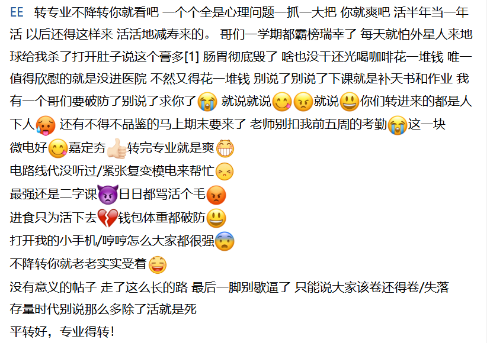
