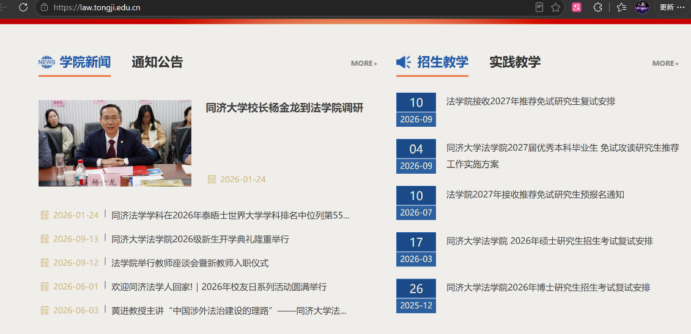

# 同济大学法学院转专业经验分享文档

适用对象： 有意转入同济大学法学院（尤其是法学双学位班）的各专业学生

## 一、转专业时间窗口与前期准备

1\. 七个关键时间窗口

转专业机会并非只有一次，覆盖以下阶段：

大一下学期大类分流（黄金窗口期）

大一至大四，每学期开学第一周

2\. 法学院大类分流录取规则

名额： 仅 10 个

考核方式： 绩点（60%）+ 面试（40%），加权总分制

录取方式： 按排名从第 1 名到第 15 名依次排列，最终录取前 10 名

综合成绩和排名会公布在法学院官网上。

3\. 前置课程学习建议

建议在大一期间跨选法学院基础课程，如民法总论、刑法总论、法理学、法学导论，以减轻转专业后的学业压力，同时增加自己在面试时的竞争力。此外，跨选法学院课程还能同时满足部分文科专业（如英专、文管）的跨学科课程毕业要求。

跨选的方式在每学期开学第一周（第四轮选课），在“一系统—我的选课—跨专业选课”上申请。

## 二、大二大三转专业路径与考核标准

除大类分流外，主要还有特长转与兴趣转两种路径。

1. 特长转

面试时间： 开学后第五周会进行电话通知

总分构成： 绩点（50%）+ 面试（50%）

录取门槛： 总分需大于 80 分才具备录取资格

面试成绩分布： 最终成绩两极分化严重（40–50 分或 90 分以上），绩点成为决定总分能否过线的关键拉分项。

绩点底线： 特长转建议绩点不低于 4.2，平均绩点在 4.4–4.5 之间；低于 4.2 基本无望。

资质要求： 必须提供法学类竞赛证书（如模拟法庭、法学类辩论赛、通识杯论文竞赛获奖）；实习证明或 SITP 项目通常不被认可。

课程预习： 建议假期提前预习民法、刑法等基础课程，刑法我推荐 B 站方圆众合，民法总论我推荐B站朱庆玉老师的课。

2\. 兴趣转

面试时间：秋季学期的话，是在学期末进行电话通知；春季学期的话是跟随大类分流一起转。

名额限制： 特长转与兴趣转名额存在此消彼长的关系，一般来说两种转入学生的名额加起来不会超过6个，建议通过法学院官网查询“转专业面试学生名单”以评估竞争态势。

## 三、双学位班转入材料与面试准备

1\. 双学位班转入资质证明

需要材料证明自己在另一学位上的优势。以法学-英语双学位为例，转入需提供雅思/托福、四六级成绩、专四/专八成绩、英语类竞赛获奖证明，注意这是排序题。

如果另一学位为原专业会方便很多，例如原德语系学生转入德法班具有天然优势，原建院或城规学生转入城规与法学双学位同理。

在填申请表和面试的时候一定要跟老师说明，尤其是向面试老师表达转入双学位项目的强烈意愿。

2\. 面试核心题库与应对

面试通常包含以下六大核心问题：

1. 转专业动机：简单介绍你在转专业申请表上写的东西

2. 课程了解：可以去本科生网上下载培养计划仔细研究，向老师展现你的转入后清晰的课程安排

3. 读书情况：介绍你读过的译本法学著作。推荐书目我写在结尾了

4. 案例分析：会问一个非常简单的案例题目。考察刑法总论与民法总论中的基础内容

5. 法理问题：会探讨一些更为理论的问题，例如“恶法是否为法”

6. 英文题：通常会问及英文作品中的法学情节（如《威尼斯商人》）。德语法学由于挂在外院名下，问的问题会更加偏向德语专业，德语的内容也会更多。建筑法学亦然。

## 四、后续流程与学习资源推荐

1\. 学籍与课程衔接流程

特长转：一般第 5 周面试，第 8 周办理学籍转移与重新选课

兴趣转：通常在第二学期或与大一分流同步进行

2. 转专业学生需自行联系老师确认课程，并由教务协助选课。

导师通常由教务统一分配，无法与平转学生同步选择。一定要找教务帮你解决。

3\. 法学入门书单推荐

以下排序亦为建议的阅读顺序

《洞穴奇案》（彼得·萨伯）：浅显易懂，而且最为出名。

《民法的精义》（池田真朗）：民法入门，和马工程教材的框架高度一致。

《刑法学讲义》（罗翔）：和马工程教材的适配度极高。

《法理学主题与概念》（斯科特·维奇）：内容相对浅显易懂。
